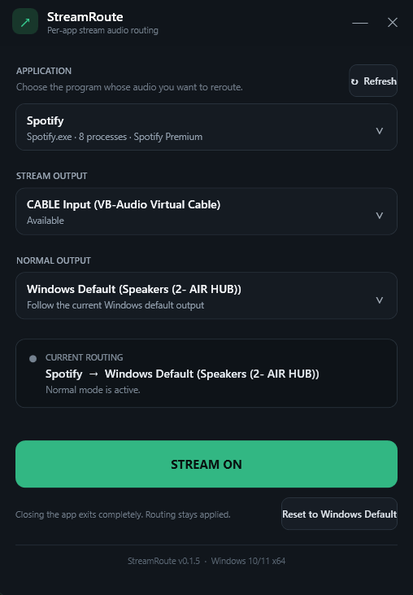

# StreamRoute

StreamRoute is a small Windows utility that routes one running application's audio between a **Stream Output** and a **Normal Output**. It uses Windows' per-application audio routing, so the selected route remains in effect after StreamRoute closes.

## Download

Open [Releases](https://github.com/Ghanemla/StreamRoute/releases) and download **StreamRoute-Setup.exe** from the latest release. Run the installer, launch StreamRoute, and choose your application and outputs.

[Download StreamRoute-Setup.exe](https://github.com/Ghanemla/StreamRoute/releases/latest/download/StreamRoute-Setup.exe)

The installer is self-contained. Normal users do not need the .NET SDK or any build tools.

## What it does

StreamRoute gives a running Windows application two selectable destinations:

- **Stream Output**: the playback device used while stream mode is active.
- **Normal Output**: the playback device restored when stream mode is off.

A common setup is **Spotify -> VB-CABLE -> OBS**, which lets OBS capture Spotify while the user does not hear it through their speakers or headphones. [VB-CABLE](https://vb-audio.com/Cable/) is optional and is only needed when a workflow requires a virtual audio device. StreamRoute can route to any available Windows playback device.

## Features

- Per-application audio routing for running Windows apps.
- Selectable Stream and Normal playback devices.
- Current-routing status, including multi-process applications.
- Refresh for newly opened applications and connected devices.
- Saved application, device, and mode selections between launches.
- Reset-to-default recovery for the selected application.
- Focused dark UI with no tray process, service, account, telemetry, updater, or startup task.

## Requirements

- Windows 10 version 2004 or later, or Windows 11.
- x64 processor and operating system.
- A running target application with an active Windows process.
- Optional: a virtual playback device such as VB-CABLE for capture-only workflows.

## Installation

1. Go to [Releases](https://github.com/Ghanemla/StreamRoute/releases).
2. Open the latest release and download **StreamRoute-Setup.exe**.
3. Run the installer.
4. Launch StreamRoute from the Start menu or the optional desktop shortcut.

StreamRoute v0.1.5 is not code-signed, so Windows may show an unknown-publisher or SmartScreen warning. Confirm that the installer came from this repository's official Releases page before continuing.

## Basic usage

1. Start the application whose audio you want to route.
2. Open StreamRoute and select the application. Use **Refresh** if it is not listed.
3. Choose a **Stream Output**.
4. Choose a **Normal Output**. **Windows Default** follows the current Windows default playback device.
5. Select **STREAM ON** to route the application to the Stream Output.
6. Select **STREAM OFF** to restore the Normal Output.

StreamRoute applies the route to all running processes with the selected executable name, which supports multi-process apps such as Spotify and browsers. The selected application must be running when a route is changed or reset.

## STREAM ON and STREAM OFF

- **STREAM ON** sends the selected application to the configured Stream Output.
- **STREAM OFF** sends it back to the configured Normal Output.

The status panel shows the route Windows currently reports. Some multi-process applications have helper processes that remain on Windows Default; StreamRoute keeps the last explicitly selected mode instead of letting those helper processes flip the toggle state.

## OBS example

1. Install VB-CABLE if a virtual audio device is needed.
2. In StreamRoute, select Spotify as the application.
3. Set **Stream Output** to **CABLE Input (VB-Audio Virtual Cable)**.
4. Set **Normal Output** to your speakers, headphones, or **Windows Default**.
5. In OBS, add an **Audio Input Capture** source and select **CABLE Output (VB-Audio Virtual Cable)**.
6. Select **STREAM ON** in StreamRoute. OBS receives Spotify through VB-CABLE while Spotify is not sent to the Normal Output.
7. Select **STREAM OFF** when finished to return Spotify to the Normal Output.

## Reset to Windows Default

**Reset to Windows Default** removes the selected application's custom route and returns it to the current Windows default playback device. It affects only the selected application; other applications' routes are left unchanged.

## Settings and app lifecycle

StreamRoute remembers the selected application, Stream Output, Normal Output, and last mode in `%LocalAppData%\StreamRoute\settings.json`.

Closing the window fully exits StreamRoute. It does not remain in the notification area and uses no CPU or memory afterward. The route already applied by Windows remains active.

## Build from source

Building is only necessary for developers who want to inspect or modify the source.

Requirements:

- Windows 10/11 x64.
- .NET 10 SDK.
- Inno Setup 6 or 7.

Run `BUILD.bat` from the repository root. It restores packages, publishes a self-contained Release x64 build, and creates `dist\StreamRoute-Setup.exe`. If a required build tool is missing, the script can install it after asking for confirmation.

For quick development runs without producing an installer, use `RUN-DEV.bat`.

## Technical note

StreamRoute uses the same Windows per-app audio policy mechanism exposed by Volume Mixer-style routing tools. This Windows interface is undocumented and could require an interoperability update after a future Windows release.

Third-party licenses and attributions are in [THIRD_PARTY_NOTICES.txt](THIRD_PARTY_NOTICES.txt).
